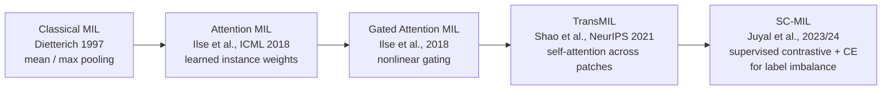

# The Evolution of Multiple Instance Learning

**From classical MIL to attention, TransMIL and SC-MIL: a literature review of weakly supervised learning for computational pathology.**

Research presentation by **Jeremiah Afari Opoku-Acheampong**, Wayne State University.
Slides: [`Evolution_of_MIL_slides.pdf`](Evolution_of_MIL_slides.pdf)

> This is a review of published work. All benchmark numbers below are reported by the original papers, cited inline; they are not my own experimental results.

---

## Why MIL matters

Real-world labels are often coarse. A pathology slide is labeled *cancerous*, but nobody marks which of its thousands of patches contains the tumor. **Multiple Instance Learning (MIL)** learns from **bags** of instances that carry only a bag-level label:

- A bag is **positive** if at least one instance in it is positive.
- A bag is **negative** if none are.

Dietterich et al. (1997) explained this with a keychain: each bag is a keychain, each instance a key. If any key opens the lock, the keychain is positive. Their motivating case was drug discovery, where a molecule (bag) is active if any of its conformations (instances) binds the target.

## How the field evolved



| Method | Key idea | What it fixed | What it still lacked |
| --- | --- | --- | --- |
| **Classical MIL** (mean/max pooling) | Fixed pooling over hand-crafted instance features | Learning from bag labels at all | No learned features; max is non-differentiable; no end-to-end training; scales poorly |
| **Attention MIL** | A small network scores each instance; the bag embedding is the attention-weighted sum | Differentiable, end to end, and interpretable (attention shows which instances mattered) | Treats instances independently, so no spatial or contextual relations |
| **Gated Attention MIL** | Adds a sigmoid gate to the tanh attention branch | Richer, more stable attention | Still no relationships between instances |
| **TransMIL** | Transformer self-attention across all patches, with positional encoding, before pooling | Global context and long-range dependencies across the slide | Self-attention is quadratic in the number of patches; memory heavy; overfits small datasets |
| **SC-MIL** | Supervised contrastive loss on bag embeddings, blended with cross-entropy on a curriculum | Class imbalance at the dataset level and within slides | Adds training complexity: sampling strategy and temperature to tune |

## Reported results

**Attention MIL on MNIST-bags** (Ilse et al., 2018): bags of about 50 digit images, 50 to 500 training bags. Attention and gated attention reach AUC above 0.99 even with few bags, while instance-level mean and max pooling trail.

**TransMIL on whole-slide images** (Shao et al., 2021):

| Dataset | Accuracy | AUC |
| --- | ---: | ---: |
| CAMELYON16 | 0.8837 | 0.9309 |
| TCGA-NSCLC | 0.8835 | 0.9603 |

TransMIL reported the best accuracy and AUC against ABMIL, MIL-RNN, DSMIL, CLAM and pooling baselines on these datasets, plus TCGA-RCC.

**SC-MIL under label imbalance** (Juyal et al., 2023): best F1 and AUC on out-of-distribution NSCLC across imbalance ratios. Random sampling beat class-balanced sampling, plausibly because over- or under-sampling reduces feature diversity, and the models were robust to contrastive temperature (τ in {0.1, 0.5, 1}).

## Takeaways

1. **Learned pooling beats fixed pooling.** Attention made MIL trainable end to end and interpretable.
2. **Context matters.** Modeling how patches relate (TransMIL) improves slide-level classification, at a quadratic compute cost.
3. **Representation first, classifier second.** Under heavy imbalance, contrastive representation learning followed by classifier learning (SC-MIL) generalizes better, including out of distribution.

## Reproduction: attention MIL on MNIST-bags

[`attention_mil_mnist_bags.ipynb`](attention_mil_mnist_bags.ipynb) is a from-scratch PyTorch reimplementation of the MNIST-bags experiment from Ilse et al. (2018). Bags of MNIST digits are labeled positive if they contain a **9**; the model never sees which digit is the 9. It compares **mean**, **max**, **attention** and **gated attention** pooling across training-set sizes and seeds, and checks whether attention lands on the 9s.

```bash
pip install -r requirements.txt
python attention_mil_mnist_bags.py        # or open the notebook; about 10-20 minutes on a CPU
```

Results are written to `results/` (`results.md`, `results.json`, `auc_vs_train_bags.png`, `attention_example.png`).

## References

1. Dietterich, T. G., Lathrop, R. H., & Lozano-Pérez, T. (1997). Solving the multiple-instance problem with axis-parallel rectangles. *Artificial Intelligence*, 89(1–2), 31–71.
2. Ilse, M., Tomczak, J. M., & Welling, M. (2018). [Attention-based deep multiple instance learning](https://proceedings.mlr.press/v80/ilse18a.html). *ICML 2018*.
3. Shao, Z., Bian, H., Chen, Y., Wang, Y., Zhang, J., Ji, X., & Zhang, Y. (2021). [TransMIL: Transformer based correlated multiple instance learning for whole slide image classification](https://proceedings.nips.cc/paper/2021/hash/10c272d06794d3e5785d5e7c5356e9ff-Abstract.html). *NeurIPS 2021*.
4. Juyal, D., et al. (2024). [SC-MIL: Supervised contrastive multiple instance learning for imbalanced classification in pathology](https://openaccess.thecvf.com/content/WACV2024/html/Juyal_SC-MIL_Supervised_Contrastive_Multiple_Instance_Learning_for_Imbalanced_Classification_in_WACV_2024_paper.html). *WACV 2024* ([arXiv:2303.13405](https://arxiv.org/abs/2303.13405), 2023).

Figures in the slides are reproduced from the cited papers for teaching purposes, with attribution.
